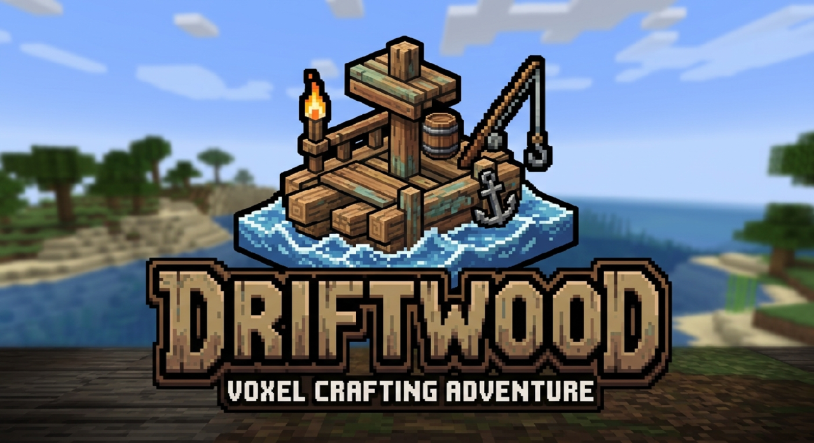

Driftwood is an open-world survival crafting game built from scratch in C# and OpenGL. Start with
empty hands, gather materials, make tools and workstations, build, explore, fight, trade, learn
magic, command companions, and return to the same persistent procedurally generated world later.

[**Download v0.8.0 for Linux and Windows**](https://github.com/codingncaffeine/Driftwood/releases/tag/v0.8.0)
· [**Player handbook**](https://github.com/codingncaffeine/Driftwood/wiki)
· [Release notes](https://github.com/codingncaffeine/Driftwood/releases/tag/v0.8.0)

## What is in the game?

- Seeded worlds with mountains, rivers and wide seas, biomes, caves, ore seams, ruins, settlements,
  weather, flowing water and lava, and a deep molten Emberdeep region.
- Destructible terrain, building, storage, nearly 400 crafting recipes, smelting, brewing, farming,
  beekeeping, fishing, rails, signals, armour, shields, bows, thrown items, hunger, breath and fire.
- Boats, and ships you build, steer and moor as one body.
- Forty kinds of creature, from farm animals and bees to the Deepwatch's guardians, the Emberdeep's
  monsters, and two bosses: the Core Wyrm and the Ashwraith.
- Eight authored exploration-site families, persistent discoveries and encounters, resident trading,
  treasure routes, an explored-world map, saved waypoints, and an achievement tree.
- Classless progression to level 20 with four attributes, gold, a character sheet, 19 spells, four
  automatic spell ranks, eight prepared slots, three loadouts, and four commanded companions.
- Cascaded shadows, ambient occlusion, HDR and bloom, temporal antialiasing, pack-aware weather and
  materials, refractive water, and material-matched interaction and spell particles.
- Keyboard and mouse plus SDL3 controller support, rebindable controls, controller spell banks,
  radial hotbar selection, target assist, rumble, and controller navigation throughout the UI.
- Local and Modrinth-backed shelves for texture and sound packs, plus local and online player skins.

Driftwood is a playable game for Linux and Windows on x64; the current release is v0.8.0 on both.
Play alone, or open your world to friends for co-op: they join by address, by a join code you send
them, or from the Friends' Worlds list, with no server to run. The host's machine keeps the world,
and each friend's character is kept there for their next visit. Exact current content and control counts are
generated from the game registries in the
[live reference](https://github.com/codingncaffeine/Driftwood/wiki/Live-Registry-Reference).

## Play

### Linux

On Debian or Ubuntu, download `driftwood-game_0.8.0-1_amd64.deb` from the
[release page](https://github.com/codingncaffeine/Driftwood/releases/tag/v0.8.0) and install it with
`sudo apt install ./driftwood-game_0.8.0-1_amd64.deb`; it adds Driftwood to the application menu and a
`driftwood-game` command. On Arch, install `driftwood-game-bin` from the AUR.

Anywhere else, download `Driftwood-v0.8.0-linux-x64.tar.gz` from the
[release page](https://github.com/codingncaffeine/Driftwood/releases/tag/v0.8.0), extract it anywhere, and run
`./Driftwood` from the extracted folder. Run `./install.sh` once to add Driftwood to your application
menu (`./install.sh --uninstall` removes it again). The build is self-contained: it does not need .NET,
and it brings its own GLFW, OpenAL and SDL. It runs on Ubuntu 22.04, Debian 12, Fedora, Arch, or
anything newer with glibc 2.35, under Wayland or X11 on any desktop, and needs an OpenGL 3.3 driver.
Worlds, packs and skins live in `~/.local/share/Driftwood`, settings in `~/.config/Driftwood`.

### Windows

Download `Driftwood-v0.8.0-win-x64-setup.exe` from the
[release page](https://github.com/codingncaffeine/Driftwood/releases/tag/v0.8.0) and run it. It installs
for your account only (no administrator prompt) into `%LOCALAPPDATA%\Programs\Driftwood`, adds Start
menu and optional desktop shortcuts, and can be removed from **Settings › Apps**; uninstalling keeps
your worlds. If you would rather not install anything, `Driftwood-v0.8.0-win-x64.zip` is the same game:
extract it anywhere and run `Driftwood.exe`. Either way it is self-contained and needs no .NET, on
Windows 10 or 11 with an OpenGL 3.3 driver. Worlds, packs, skins and settings live in
`%APPDATA%\Driftwood`.

Driftwood is not code-signed, so the first time you run the installer (or the exe) Windows may show
"Windows protected your PC". Choose **More info**, then **Run anyway**. Each download has a `.sha256`
beside it on the release page if you want to check the file first. The first time you open a world to
friends, Windows Firewall asks whether Driftwood may use the network; allow it on private networks.

On a first day:

1. Choose **Play** on the title menu, or **Create New World** to name one and pick a seed.
2. Break a log with empty hands and collect it.
3. Open the inventory and make planks, sticks, and basic tools.
4. Build a bench for the full crafting grid, then make storage and a furnace.
5. Find food and shelter, set a bed after dark, and begin exploring.

The [Getting Started guide](https://github.com/codingncaffeine/Driftwood/wiki/Getting-Started)
continues from there.

## Basic controls

| Input | Action |
| --- | --- |
| `WASD` or arrows | Move |
| `Space` / `Ctrl` / `Shift` | Jump / sneak / sprint |
| Hold left / right mouse | Mine or attack / place or use |
| `E` or `I` | Inventory, equipment, and character tabs |
| `B` | Fold the recipe book in or out |
| `M` | Open or close the explored-world map |
| Hold `R` | Release mouse-look and click a prepared spell |
| `Esc` | Pause, options, packs, skins, and back to the main menu |

Every key and discrete controller action is rebindable. See
[Controls and Controller](https://github.com/codingncaffeine/Driftwood/wiki/Controls-and-Controller)
for the full keyboard, UI, spell, pet, and gamepad layouts.

## Handbook

The [Driftwood wiki](https://github.com/codingncaffeine/Driftwood/wiki) owns the detailed
documentation, organized by subject:

- [Survival](https://github.com/codingncaffeine/Driftwood/wiki/Survival),
  [gathering and mining](https://github.com/codingncaffeine/Driftwood/wiki/Gathering,-Tools-and-Mining),
  [crafting](https://github.com/codingncaffeine/Driftwood/wiki/Crafting,-Stations-and-Recipes),
  the full [recipe list](https://github.com/codingncaffeine/Driftwood/wiki/Recipe-List),
  [brewing](https://github.com/codingncaffeine/Driftwood/wiki/Brewing-and-Potions), and
  [combat](https://github.com/codingncaffeine/Driftwood/wiki/Combat,-Equipment-and-Projectiles)
- [Boats and ships](https://github.com/codingncaffeine/Driftwood/wiki/Boats-and-Ships),
  [the Emberdeep and the Core](https://github.com/codingncaffeine/Driftwood/wiki/The-Emberdeep-and-the-Core),
  and [achievements](https://github.com/codingncaffeine/Driftwood/wiki/Achievements)
- [World, biomes, and fluids](https://github.com/codingncaffeine/Driftwood/wiki/World,-Biomes-and-Fluids),
  [creatures and spawning](https://github.com/codingncaffeine/Driftwood/wiki/Creatures-and-Spawning),
  [exploration and trading](https://github.com/codingncaffeine/Driftwood/wiki/Exploration-and-Trading),
  and [graphics and effects](https://github.com/codingncaffeine/Driftwood/wiki/Graphics-and-Effects)
- [Progression and magic](https://github.com/codingncaffeine/Driftwood/wiki/Magic-and-Progression),
  including generated descriptions and rank tables for every spell
- [Texture packs](https://github.com/codingncaffeine/Driftwood/wiki/Texture-Packs),
  [skins](https://github.com/codingncaffeine/Driftwood/wiki/Skins), and
  [audio and sound packs](https://github.com/codingncaffeine/Driftwood/wiki/Audio-and-Sound-Packs)
- [Saves and recovery](https://github.com/codingncaffeine/Driftwood/wiki/Saves-and-Recovery),
  [troubleshooting](https://github.com/codingncaffeine/Driftwood/wiki/Troubleshooting), and
  [developer tools and architecture](https://github.com/codingncaffeine/Driftwood/wiki/Developer-Tools-and-Architecture),
  with a separate [command-line reference](https://github.com/codingncaffeine/Driftwood/wiki/Command-Line-Reference)

## Build from source

The source build requires the .NET 11 SDK. On Linux:

```text
./build-release.sh
```

On Windows, `build-release.bat`. Either runs `dotnet build Driftwood.sln -c Release`, and the client
lands under `src/Driftwood.Client/bin/Release/net11.0`. `./publish-release.sh` builds, gates and
packages every release download on Linux, the Windows zip and installer included (it needs `xvfb-run`,
`dbus-run-session`, `zip`, and podman or docker); the `Windows gate` workflow then runs that same
Windows build's checks on a Windows machine before the release is published. Release packaging, audits, visual checks, command-line tools, and
the source layout are documented in
[Developer Tools and Architecture](https://github.com/codingncaffeine/Driftwood/wiki/Developer-Tools-and-Architecture).

Driftwood's code is free and open-source under [GPL-3.0-only](LICENSE).
